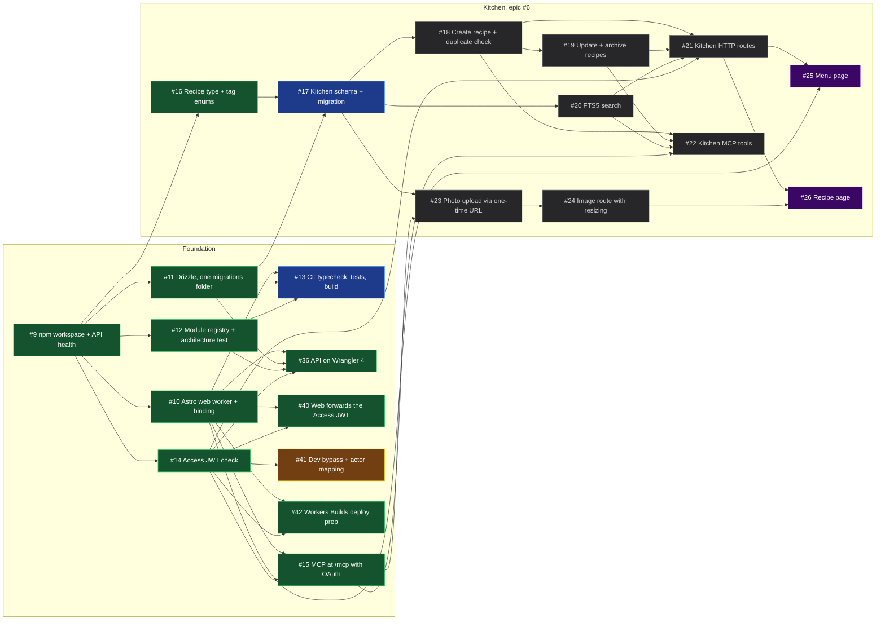

# Roadmap

> Every open GitHub issue in `WH1TE-SHAD0W/command-center`, how the issues depend on one another,
> and what can start now. The issues are the source of record: this page only arranges them. The
> edges come from each issue's **Notes → Depends on** line, and the same edges are set as GitHub's
> native "blocked by" links. Where an issue gives no dependency, none is drawn and no order is
> invented. Snapshot taken 2026-11-28. The owner's decisions are recorded as comments on each issue.

## Where things stand

| State | Meaning | Issues |
|---|---|---|
| **Done** | closed (merged) | #9, #10, #11, #12, #14, #15, #16, #36, #40, #42 |
| **In progress** | a session is building it, or its PR is open | #13 (PR #49), #17 (PR #50) |
| **Unblocked, needs your decision** | every dependency is closed, but a **Decision needed** is open | #41 |
| **Locked** | at least one dependency is still open | #18–#24 |
| **Design pending** | on hold until UI design issues exist, even once unlocked | #25, #26 |
| **Not broken down** | the original module tickets; no child issues yet | #1, #2, #3, #4, #5 |
| **Idea, not decided** | needs its open questions answered (and maybe an ADR) | #7, #28, #29, #30, #31, #32 |

## Dependency graph

## Waves

A wave is the set of issues whose dependencies are all in earlier waves, so the issues inside one
wave can run in parallel. This is dependency depth only, not a priority you have set.

| Wave | Issues | Unblocked by |
|---|---|---|
| 0 | #9 ✅ | — |
| 1 | #10 ✅, #11 ✅, #12 ✅, #14 ✅, #16 ✅ | #9 |
| 2 | #13, #15 ✅, #17, #36 ✅, #40 ✅, #41, #42 ✅ | #13 ← #10 #11 #12 · #15 ← #10 #14 · #17 ← #11 #16 · #36 ← #10 #11 #12 #14 · #40, #42 ← #10 #14 · #41 ← #14 |
| 3 | #18, #20, #23 | #17 (and #15 for #23) |
| 4 | #19, #24 | #18 · #23 |
| 5 | #21, #22 | #18 #19 #20, plus #14 (#21) or #15 (#22) |
| 6 | #25, #26 (design pending) | #21, plus #10 (#25) or #24 (#26) |

**Critical path to the kitchen API:** #17 → #18 → #19 → #21 / #22, with the photo chain
#17 → #23 → #24 beside it. #17 is now the only open gate: once it merges, #18, #20 and #23 can start
in parallel. The pages #25 and #26 also wait for UI design.

**Parallel caution:** parallel PRs conflict in `package-lock.json` and shared files. Each branch
merges `main` in (no rebase, no force-push) before it is merged.

## Every issue

### Foundation (scaffold)

| # | Issue | Depends on | Built by | Decisions |
|---|---|---|---|---|
| 9 | Scaffold the npm workspace and the API worker with a health route | — | — | ✅ closed |
| 10 | Scaffold the Astro web worker with the service binding to the API | #9 | Claude Code | ✅ merged (#37): no SESSION/IMAGES bindings; Svelte installed only |
| 11 | Set up Drizzle (one shared migrations folder, ADR 0013) | #9 | Claude Code | ✅ merged (#38): no collector, no `d1-migrations/` |
| 12 | Add the module registry and the architecture test | #9 | Claude Code | ✅ merged (#35): routes only, tools left to #15 |
| 13 | Add GitHub Actions for typecheck, tests and build | #9 #10 #11 #12 | Claude Code | PR #49 open: one check per job (typecheck, test, architecture, build, cloudflare-build) |
| 14 | Validate the Cloudflare Access JWT on every API request | #9 | Claude Code | ✅ merged (#39): `CLOUDFLARE_ACCESS_TEAM_DOMAIN`, `CLOUDFLARE_ACCESS_AUD`; JWKS cached in `OAUTH_KV` |
| 15 | Serve the MCP server at /mcp with workers-oauth-provider | #10 #14 | Claude Code | ✅ merged (#46): optional `OAUTH_CONSENT_SECRET` remembers consent |
| 36 | Upgrade the API worker to Wrangler 4 | #10 #11 #12 #14 | Claude Code | ✅ merged (#47): vitest 5 with `@cloudflare/vitest-plugin` |
| 40 | Forward the Access JWT from the web worker to the API | #10 #14 | Claude Code | ✅ merged (#44): forwards only `Cf-Access-Jwt-Assertion` |
| 41 | Add the local dev bypass and actor mapping to the Access check | #14 | Claude Code / you | **open**: how the bypass is switched on; the `actor` shape |
| 42 | Prepare the repository for Cloudflare Workers Builds deploys | #10 #14 | Claude Code | ✅ merged (#45): remote D1 migrations stay manual; real resource IDs in #48 |

### Kitchen (epic #6)

| # | Issue | Depends on | Built by | Decisions |
|---|---|---|---|---|
| 16 | Add the recipe type and recipe tag enums | #9 | Claude Code | ✅ merged (#34), kebab-case values; tags: bbq, meat, sweet, slovak, sunday dish, saturday dish, friday dish, wednesday dish (extendable); type order = menu order |
| 17 | Add the kitchen schema and its first migration | #11 #16 | Claude Code | PR #50 open; text UUID id; `amount` optional number ("to taste" goes in `note`); `steps` as `string[]`; `servings` optional |
| 18 | Create recipes with a duplicate check that ignores case and accents | #17 | Hermes | an archived recipe does not block the same name (same-name variants will exist later) |
| 19 | Update and archive recipes | #18 | Hermes | unarchive allowed; duplicate check on unarchive proposed in the PR |
| 20 | Search recipes with FTS5, ignoring accents | #17 | Hermes | SQL triggers |
| 21 | Add the kitchen HTTP routes | #14 #18 #19 #20 | Hermes | paths as proposed; unarchive path proposed in the PR |
| 22 | Add the kitchen MCP tools | #15 #18 #19 #20 | Hermes | none listed |
| 23 | Upload recipe photos through a one-time URL into R2 | #15 #17 | Claude Code / you | 20 MB; jpeg, png, webp; tokens in a D1 table |
| 24 | Serve recipe images at /img/<key> with resizing | #23 | Hermes | 320, 640, 960, 1280 |
| 25 | Show the menu page grouped by dish type | #10 #21 | Hermes | **design pending**; menu and recipe page easy to use on a phone |
| 26 | Show the recipe page with every field | #21 #24 | Hermes | **design pending**; easy to use on a phone |

### Modules not broken down yet

These are the original tickets. Each is split into scaffold-style child issues (acceptance criteria
and "Depends on" lines) before any of it is built. All of them sit on top of the foundation
(#10–#15). **Order, decided 2026-11-27: #1 → #3 → #2 → #5 → #4.** Infrastructure stays pluggable: a
watched service is either connected as an integration or listed as configuration of the watchtower
itself.

| # | Issue | Module | Notes |
|---|---|---|---|
| 1 | Cron pipelines: Instagram, Confluence backup, nightly check-ins | `jobs`, `checkins` | Check-in format still open (context §8); check-ins tick habits (#5) |
| 3 | Meetup problem survey and architecture pipeline | `ideas` | Open: triage and blueprint flow (context §8 Q12) |
| 2 | Uptime Watchtower | `watchtower` | Open: targets, history, graphs, alerts, and how the LAN probe gets in (context §8 Q7, Q8, Q13) |
| 5 | Personal habit tracker | `habits` (+ character) | Defined in context §5.2. The issue text still says "streak counters"; context §5.2 governs (left as is by choice) |
| 4 | Portfolio redesign | none (separate repo) | Here, at most a public `/status` feed; needs #2 and an ADR (context §8 Q15) |

### Factory (docs/specs/factory.md)

How the software factory works, not app features. No dependencies on the module issues.

| # | Issue | Delivers | State |
|---|---|---|---|
| 52 | Add a learning loop to the agent factory | Lessons in every PR, `/retro`, `factory-steward` (ADR 0014) | ✅ merged (#53) |
| 89 | Complete spec-driven development with living module specs | `docs/specs/`, `spec-writer`, CI traceability (ADR 0015) | ✅ merged (#90) |
| 94 | Keep the public docs current and conform the factory to its spec | README, `docs/guide/`, FAC-001–008 | in progress |

### Ideas, not decided

| # | Idea | Leans on |
|---|---|---|
| 7 | Share the recipe menu with guests | the kitchen epic #6 |
| 28 | Dawarich location history as a location module | — (Strava and Garmin split out into #31, #32) |
| 29 | The app's own roadmap as a tech tree from GitHub issues | this page's data; needs GitHub "blocked by" links on the issues |
| 30 | A character skill tree tied to goals across modules | #5 habits, events from the other modules |
| 31 | Strava activities as a fitness connector | split out of #28 |
| 32 | Garmin health data as a fitness connector | split out of #28 |

## Not on this map yet: UI design

There are no issues for the visual design (theme, layout, how images and the menu are shown). Until
there are, the work is data and API only: #25 and #26 stay on hold, and design work may still change
requirements here (for example the image widths in #24). When design issues are filed, they get
their own section and edges.

## Deploys

Both workers are connected to Cloudflare Workers Builds and deploy on every push to `main`
(2026-11-28). The settings are in `docs/development.md`. The API (`command-center-api`) runs with its
real D1, R2 and KV bindings (#48). The web worker (`command-center`) runs at `app.culak.eu` behind
Access, with the `API` service binding. The API worker has `CLOUDFLARE_ACCESS_TEAM_DOMAIN` and
`CLOUDFLARE_ACCESS_AUD` as secrets. Still to do: the Access bypass for the Hermes paths (`/mcp`,
`/token`, `/register`, `/.well-known/oauth-*`, `/uploads/*`), needed before Hermes can connect.

## How the work is delivered

- **Now: parallel Claude Code sessions**, one per issue, each following `AGENTS.md` (own branch,
  own PR, the owner merges). An issue starts only when every issue blocking it is **merged**. After
  each merge the graph is re-checked, and whatever unlocked gets its own session.
- **Hermes Kanban (ADR 0012) is paused.** On 2026-11-27 the workers failed with `API key not valid`,
  and Gemini's free tier (20 requests a day for the Flash models) cannot carry a pipeline run. The
  owner is waiting on this rather than paying for it now.
- **#13 provides the required check** that the Kanban `pr` card waits for.

## Keeping this page current

Update it when an issue closes, a new issue is filed, or a "Depends on" line changes. The issue
always wins over this page.

When every issue of a wave is closed, run `/retro <wave>` (ADR 0014): the factory learns from that
wave's PRs, and the run is recorded below.

### Retros

| Wave | Date | Lesson issues |
|---|---|---|
| — | — | none yet; the first retro covers waves 0–2 |
